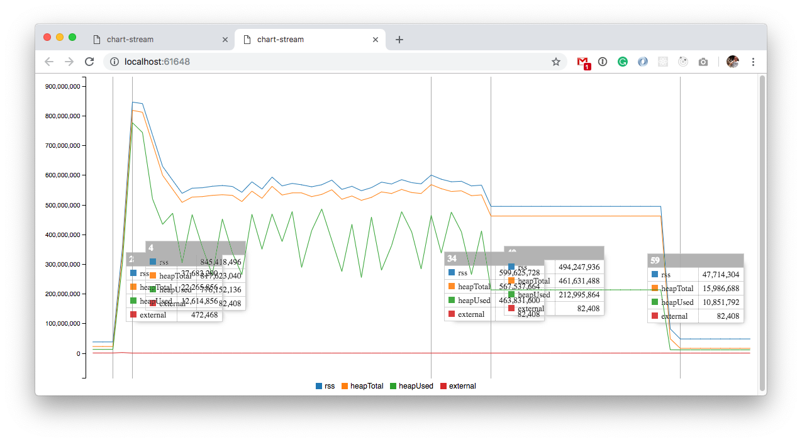
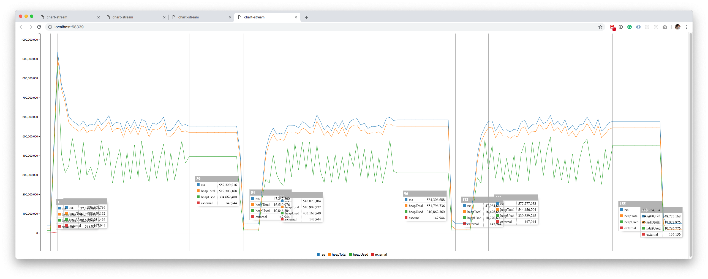
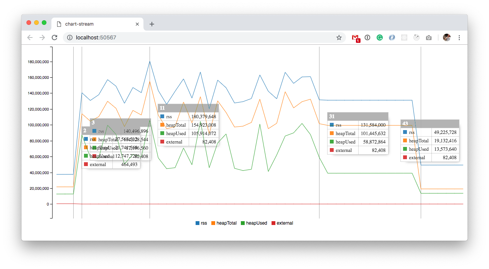
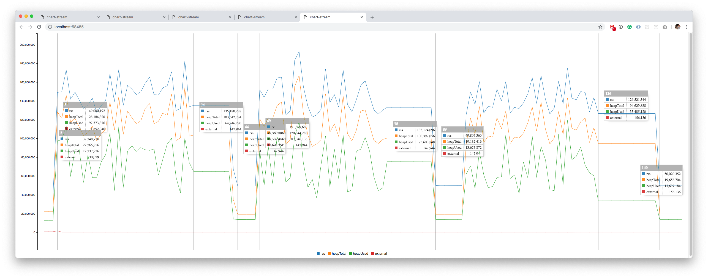

# Sentry Node SDK Memory Usage Benchmark

This repo provides a performance benchmark for the `@sentry/node` SDK found at: [https://github.com/getsentry/sentry-javascript/tree/master/packages/node](https://github.com/getsentry/sentry-javascript/tree/master/packages/node)

The file `express.js` in this repo was used to measure memory and performance improvements across Sentry SDK versions.

## Performance Results

### Historical Results (2019)
- Peak memory usage **decreased by ~80%** from version 4.5.3 → 5.x.x
- Average memory usage **decreased by ~70%** from version 4.5.3 → 5.x.x  
- **29% more requests/sec** from version 4.5.3 → 5.x.x

### Current Benchmarking (2025)
This repo has been updated to benchmark the latest Sentry SDK version **9.42.0** with modern tooling and Node.js compatibility.

## Requirements

- **Node.js**: 20.19.3+ (managed via Volta)
- **Sentry DSN**: Required for testing (add to `express.js:7`)
- **ApacheBench**: For load testing (`ab` command)

## Installation & Setup

```bash
git clone https://github.com/HazAT/sentry-node-sdk-memory-pm.git
cd sentry-node-sdk-memory-pm
npm install
```

**Configure Sentry DSN**: Edit `express.js` line 7 and replace `YOUR_DSN` with your actual Sentry DSN.

## Running Benchmarks

### Memory Monitoring (Modern Approach)
```bash
npm run start:memory
```
Uses `pidusage` for real-time memory and CPU monitoring (replaces deprecated `memory-usage` package).

### Alternative Monitoring Methods
```bash
# Chrome DevTools integration
npm run start:inspect

# Basic server start
node express.js
```

### Load Testing
After starting the server, run ApacheBench in a separate terminal:
```bash
npm run ab
# Equivalent to: ab -c 20 -n 1000 http://localhost:3000/
```

For more intensive testing (original benchmarks):
```bash
ab -c 20 -n 10000 http://localhost:3000/
```

## What's New (2025 Update)

- **Sentry SDK**: Updated from `5.11.2` → `9.42.0` (latest)
- **Memory Monitoring**: Replaced `memory-usage` with `pidusage` (Node.js 20+ compatible)
- **Modern Sentry API**: Updated to use `withScope()` and `setupExpressErrorHandler()`
- **Volta Support**: Pinned to Node.js 20.19.3 for optimal compatibility
- **Real-time Monitoring**: Added `memory-monitor.js` for live memory/CPU stats

## Expected Performance Improvements

Based on the historical results, you can expect significant performance gains when testing Sentry SDK 9.42.0 vs older versions:
- **Memory usage reduction**: 70-80% less peak memory consumption
- **Request throughput**: 25-30% more requests per second
- **CPU efficiency**: Improved error handling with OpenTelemetry integration

## Sample Output

When running `npm run start:memory`, you'll see real-time stats like:
```
Starting Express server with memory monitoring...
[1.0s] Memory: 70.6MB | CPU: 23.0%
[2.0s] Memory: 70.6MB | CPU: 0.0%
[3.0s] Memory: 70.6MB | CPU: 0.0%
```

---

# Historical Benchmark Results

## Using 4.5.3 (2019):

## Screenshot showing a graph of memory usage for 4.5.3



## Output ApacheBench command using 4.5.3 for a single run:

    ab -c 20 -n 10000 http://localhost:3000/
    This is ApacheBench, Version 2.3 <$Revision: 1826891 $>
    Copyright 1996 Adam Twiss, Zeus Technology Ltd, http://www.zeustech.net/
    Licensed to The Apache Software Foundation, http://www.apache.org/
    
    Benchmarking localhost (be patient)
    Completed 1000 requests
    Completed 2000 requests
    Completed 3000 requests
    Completed 4000 requests
    Completed 5000 requests
    Completed 6000 requests
    Completed 7000 requests
    Completed 8000 requests
    Completed 9000 requests
    Completed 10000 requests
    Finished 10000 requests
    
    
    Server Software:
    Server Hostname:        localhost
    Server Port:            3000
    
    Document Path:          /
    Document Length:        10 bytes
    
    Concurrency Level:      20
    Time taken for tests:   75.842 seconds
    Complete requests:      10000
    Failed requests:        0
    Non-2xx responses:      10000
    Total transferred:      1270000 bytes
    HTML transferred:       100000 bytes
    Requests per second:    131.85 [#/sec] (mean)
    Time per request:       151.684 [ms] (mean)
    Time per request:       7.584 [ms] (mean, across all concurrent requests)
    Transfer rate:          16.35 [Kbytes/sec] received
    
    Connection Times (ms)
                  min  mean[+/-sd] median   max
    Connect:        0    0   0.4      0      17
    Processing:    25  151 103.8    107     759
    Waiting:        8  126  93.7     89     714
    Total:         25  152 103.8    108     760
    
    Percentage of the requests served within a certain time (ms)
      50%    108
      66%    122
      75%    149
      80%    198
      90%    343
      95%    383
      98%    435
      99%    467
     100%    760 (longest request)

## Using 4.5.3 and run ApacheBench 3 times in total (after each GC):



# Using 5.x.x (2019):

**Reference branch**: [https://github.com/getsentry/sentry-javascript/tree/ref/make-sync](https://github.com/getsentry/sentry-javascript/tree/ref/make-sync)

## Screenshot showing a graph of memory usage for 5.x.x



## Output ApacheBench command using 5.x.x for a single run:

    ab -c 20 -n 10000 http://localhost:3000/
    This is ApacheBench, Version 2.3 <$Revision: 1826891 $>
    Copyright 1996 Adam Twiss, Zeus Technology Ltd, http://www.zeustech.net/
    Licensed to The Apache Software Foundation, http://www.apache.org/
    
    Benchmarking localhost (be patient)
    Completed 1000 requests
    Completed 2000 requests
    Completed 3000 requests
    Completed 4000 requests
    Completed 5000 requests
    Completed 6000 requests
    Completed 7000 requests
    Completed 8000 requests
    Completed 9000 requests
    Completed 10000 requests
    Finished 10000 requests
    
    
    Server Software:
    Server Hostname:        localhost
    Server Port:            3000
    
    Document Path:          /
    Document Length:        10 bytes
    
    Concurrency Level:      20
    Time taken for tests:   58.991 seconds
    Complete requests:      10000
    Failed requests:        0
    Non-2xx responses:      10000
    Total transferred:      1270000 bytes
    HTML transferred:       100000 bytes
    Requests per second:    169.52 [#/sec] (mean)
    Time per request:       117.983 [ms] (mean)
    Time per request:       5.899 [ms] (mean, across all concurrent requests)
    Transfer rate:          21.02 [Kbytes/sec] received
    
    Connection Times (ms)
                  min  mean[+/-sd] median   max
    Connect:        0    0   0.3      0      12
    Processing:    32  117  26.3    119     262
    Waiting:       12   99  23.1    100     231
    Total:         32  118  26.2    119     262
    
    Percentage of the requests served within a certain time (ms)
      50%    119
      66%    128
      75%    134
      80%    138
      90%    148
      95%    158
      98%    169
      99%    183
     100%    262 (longest request)

## Using 5.x.x and run ApacheBench 3 times in total (after each GC):


